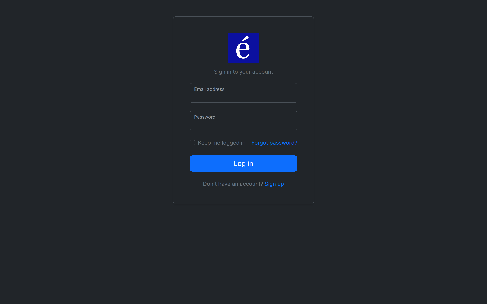
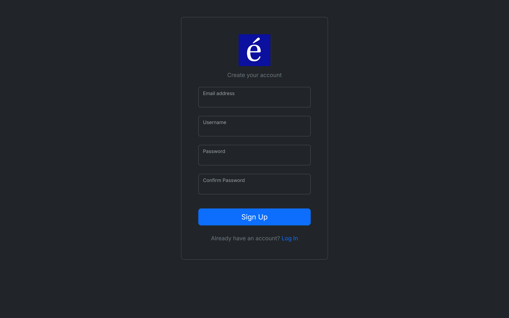
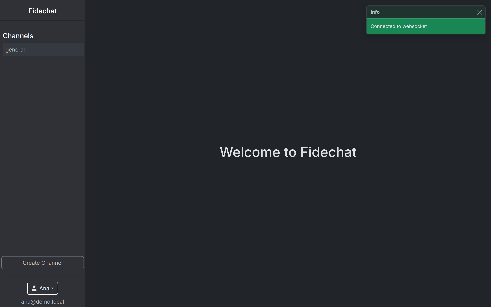
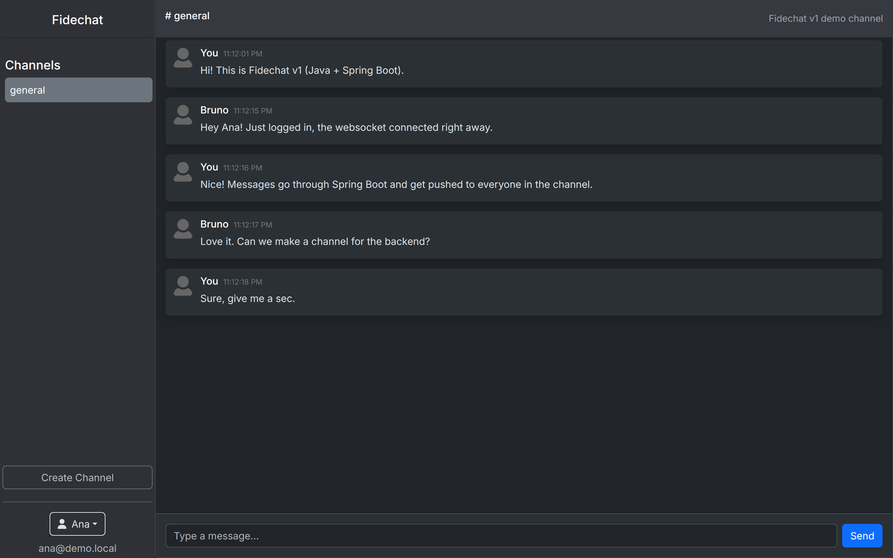
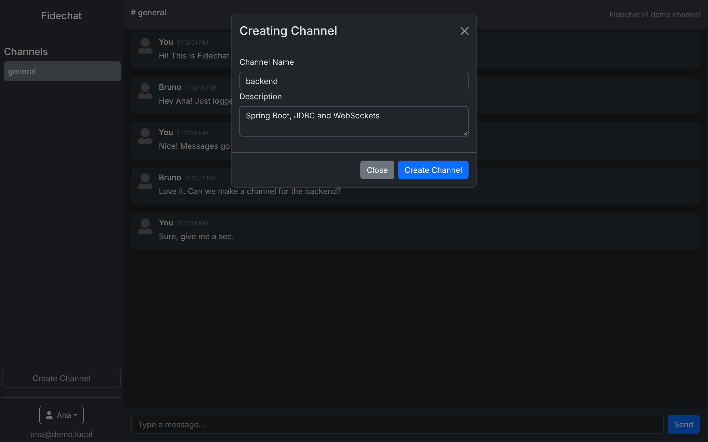
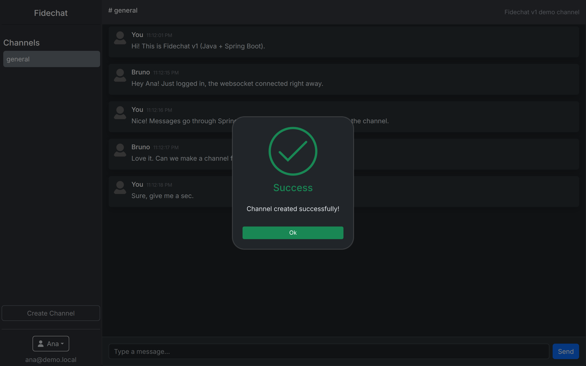
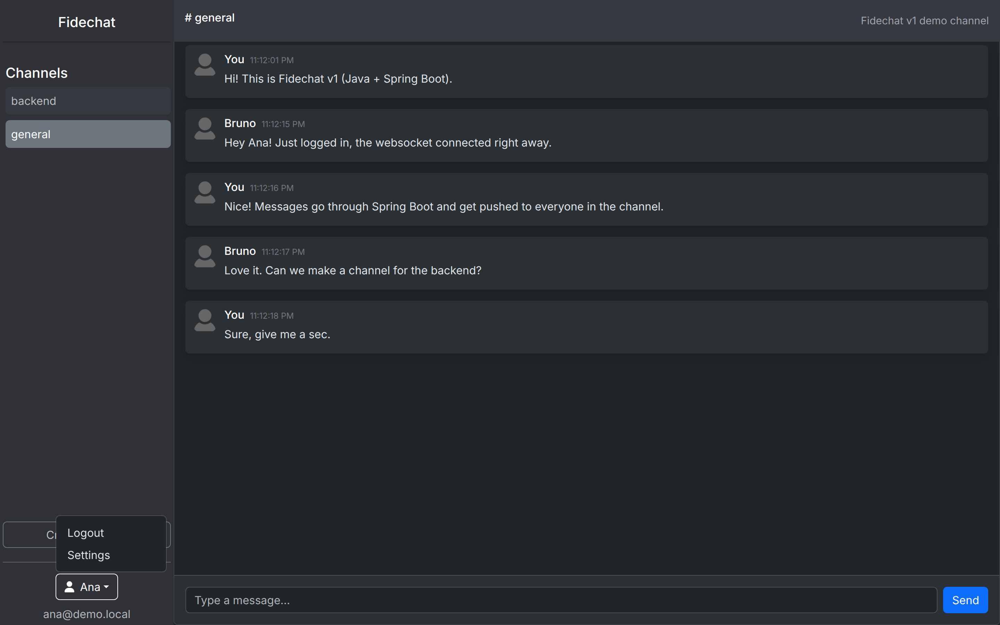
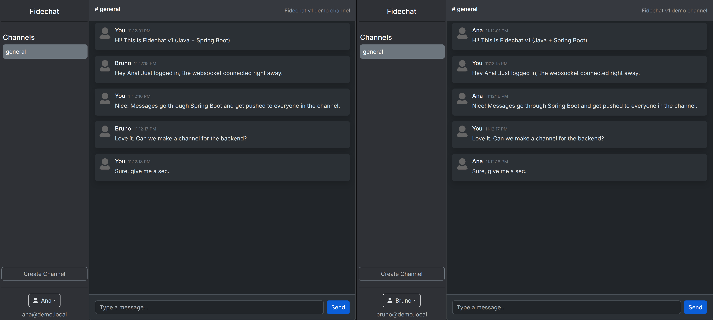

# Screenshots

How Fidechat looked in each version. Every capture comes from the real app,
built from the version's git tags (see [legacy/](../../legacy/README.md)), with
the demo users talking through the UI.

## v1: Java + Spring Boot, React + Vite (Nov 2024 – Feb 2025)

| | |
| --- | --- |
|  Login |  Sign up |
|  Home, right after the WebSocket connects |  Channel chat |
|  Creating a channel |  Channel created |
|  User menu | |

Real time: Ana (left) and Bruno (right) in the same channel, in two separate
browser sessions.

## v2: NestJS + Oracle, Next.js (Jul – Aug 2025)

_Coming once the v2 legacy environment is ready._

## v3: current version (Aug 2026 – today)

_Coming soon._
